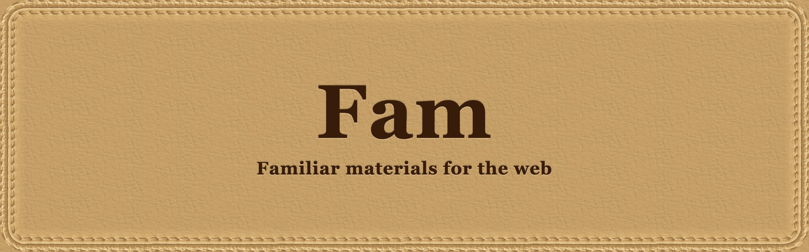

<h1 align="center"></h1>

Plain CSS for skeuomorphic interfaces in the style of Mac OS X Aqua and iOS before version 7: metal, glass, leather, wood, felt, paper, cardstock and plastic. No JavaScript required, no build step.

Fam is meant to be short and sweet, and is short for Familiar. It also stands for Fam Adds Materials, as it can be used as a full CSS framework, or just to add a little skeuomorphism as a backdrop to a modern flat UI.

Skeuomorphism exists to make an interface feel familiar. A recessed field invites typing, a raised button invites a press and a switch looks like a switch. Fam builds those cues from real photographs of materials, processed into seamless tiles and credited in [CREDITS.md](CREDITS.md), not from gradients that imitate them.

Materials tile to make textured interfaces responsive. A tile repeats at its natural size and is never stretched, so any box in any shape gets the material. There are no images per breakpoint, and a phone loads the same files as a desktop.

Textures are compact tiles to load fast. Each is between 13 KB and 85 KB, and a material you do not use is never downloaded.

## Why use it

Beyond the look:

- **Light.** The notes example (`examples/notes.html`) loads 250 KB of images and 67 KB of CSS (15.5 KB gzipped), the same at 375px and 1440px wide. There is no JavaScript.
- **Responsive without extra work.** Tiles repeat to fill any box. Photo frames are nine-sliced and the leather bar's stitched edge repeats along its length, so both fit any width.
- **Accessible, and tested.** Contrast is measured on the rendered pixels against WCAG AA, every control has a keyboard focus ring, and forced colors, disabled states and missing backdrop blur are handled. See [Accessibility](#accessibility).
- **Easy to adopt.** One stylesheet, `fam-` classes and `--fam-` custom properties. Because it is plain CSS, it sits alongside whatever framework you use.
- **Quick to recolor.** One variable tints felt (`--fam-tint`) and cardstock (`--fam-cardstock-tint`).

## Showcase

A tour of the materials in five pages: https://electrikmilk.github.io/fam/

- Home: a switcher that shows one pairing at a time, with the classes it uses.
- Pairings: scenes that combine materials: wood and felt, legal pad and leather, leather and paper.
- Materials: every texture, the felt and cardstock tints, gloss, rounding and shadows, plus navigation bars, photo frames with cork and engraved text.
- Controls: plastic, metal, glossy and glass buttons and button groups, radio buttons, tabs, the plastic panel and dial, the switch and knob, progress tubes, glass fields, the search pill, list rows, recessed fields and the leather button, each alone with its disabled look.
- Glass: frosted glass, the ambient glow and refraction, and a glass lens that follows your cursor with knobs to tune it.
- Examples: the pages in `examples/`.

The showcase's own text is set in Lato, loaded from Google Fonts. The kit itself loads no fonts.

To open it locally, build the kit and open `showcase/index.html` in a browser:

```sh
npm run build
```

`npm run site` assembles the folder that GitHub Pages publishes (`_site/`), and `.github/workflows/pages.yml` publishes it on every push to `main`.

## Use it

Link the bundle and wrap your UI in `.fam` (it only sets the font and base color):

```html
<link rel="stylesheet" href="node_modules/fam-ui/dist/fam-ui.css">
<div class="fam">...</div>
```

With a bundler you can also write `@import "fam-ui";` in CSS or `import "fam-ui";` in JavaScript; both resolve to the bundle.

One optional extra needs JavaScript: `import "fam-ui/refraction";` makes refracting glass bend along its own corner radius (see [Glass](#glass)). Leave it out and everything else works the same.

The textures are separate files in `assets/` and are only fetched when a class that uses them is on the page. If you copy the stylesheet somewhere else, copy `assets/` too and keep it next to the folder that holds the stylesheet, because the CSS refers to `../assets/`.

The same CSS is also split into layers in `css/`: `tokens`, `materials`, `effects`, `components`, `templates`. Load them in that order.

Class names start with `fam-` and custom properties with `--fam-`.

## Materials

Put a material class on any box:

- `fam-felt`: tintable felt, for screen backgrounds.
- `fam-wood`: light wood with horizontal grain, for navigation bars and panels.
- `fam-metal`: brushed metal, for plates, toolbars, navigation bars and panels.
- `fam-plastic-panel`: cream satin plastic for controls to sit on. Use it with a `fam-round-*` class.
- `fam-leather`: tan leather, for panels and fields.
- `fam-leather-bar`: tan leather with a stitched bottom edge, for navigation bars. See [Navigation](#components).
- `fam-paper`: white textured paper, for lists and note panels.
- `fam-cork`: cork, for bulletin boards. Put it inside a wood frame.
- `fam-cardstock`: natural light cardstock. Set `--fam-cardstock-tint` to multiply the texture onto a color; `#562a0e` gives brown cardstock for title bars, where white text reads well.
- `fam-legal-pad`: yellow ruled paper with a red double margin. Its rules are 24px apart, so give text a 24px line height to sit on them.

Felt is grayscale and multiplied onto one color, so one variable recolors it:

```html
<div class="fam-felt" style="--fam-tint:#8a1f2b"></div>
```

### Leather frames

`fam-leather-frame` is a photo frame with real stitching (tan). Add `fam-leather-frame--black` for black. The frame needs room for its 34px border.

```html
<div class="fam-leather-frame">...</div>
```

For any other color, use `fam-stitched`: a CSS stitched border whose thread is the leather color lifted 35% toward white. Set `--fam-leather-color` to the color of the surface, and optionally `--fam-stitch-lift` and `--fam-stitch-inset`.

```html
<div class="fam-stitched" style="--fam-leather-color:#6a2430; background:#6a2430"></div>
```

`fam-stitched` needs `-webkit-mask-box-image`. Where that is missing the stitches are hidden.

### Wood frame

`fam-wood-frame` is a moulded wood frame with a drop shadow outside and an inset shadow where the content meets the frame. Put a photo, a page or a corkboard inside it. The border is 26px; change it with `--fam-frame-width`.

```html
<figure class="fam-wood-frame"></figure>
<div class="fam-wood-frame"><div class="fam-cork">...</div></div>
```

Add `fam-wood-frame--glossy` for a glass sheen over a photo. Leave it off for a page or a board.

### Print frame

`fam-print-frame` is a print with a margin, a soft drop shadow and a faint edge around the photo. The margin is the material you pair it with: `fam-paper` for a white margin or `fam-cardstock` for a natural cardstock one (tint it with `--fam-cardstock-tint`). The margin is 14px; change it with `--fam-print-margin`.

```html
<figure class="fam-print-frame fam-paper"></figure>
<figure class="fam-print-frame fam-cardstock"></figure>
```

## Glass

Refraction only applies to Chrome, but all browsers get a nice specular ambient glow, bleeding nearby colors into the glass.

```html
<div class="fam-glass"><input class="fam-glass-input" placeholder="Search" aria-label="Search"></div>
```

Set `--fam-r` for the corner radius (default pill), or add a `fam-round-*` class, which sets it for you. A plain `border-radius` on the glass rounds the lens but not the glow, so use one of these instead. The glow's inner fade follows the rounded corners as long as the radius fits the box (at most half of its shorter side). For a pill that is wider than tall, leave `--fam-r` unset rather than setting a larger value. Also set `--fam-glow-depth`, `--fam-bleed`, the lens blur with `--fam-glass-blur` (default 14px) and `--fam-refract-blur` (default 1px, for refracting glass), and the saturation with `--fam-glass-saturate`, `--fam-glow-saturate` and `--fam-refract-saturate`. The thin clear rim is where the glow is strongest: `--fam-glow-saturate` and `--fam-glow-brightness` amplify it, `--fam-shade-inset` sets how wide the clear rim is and `--fam-glass-rim` sets the opacity of its edge line.

Add `fam-glass--refract` for clear glass that bends what is behind its rim. It needs the filter in `snippets/refraction-filter.html` somewhere in the page, once:

```html
<!-- paste the contents of snippets/refraction-filter.html -->
<div class="fam-glass fam-glass--refract"></div>
```

Refraction works in Chromium only. Other browsers show a clear glass pane with no bending. The bending strength is the `scale` attribute on `feDisplacementMap` in the snippet.

The snippet's map is one fixed image stretched over the glass, so it bends the straight sides more than the corners of a rounded pane or a circle. For bending that follows the glass's own corner radius, also load the optional refraction script, the one piece of JavaScript the kit offers. It gives each `fam-glass--refract` a filter built from that element's size and radius, and rebuilds it when either changes, including a change to `--fam-r` or a `fam-round-*` class. The bending strength is the `DISPLACEMENT_SCALE` constant in the script, and the static filter stays in place as the fallback.

```js
import 'fam-ui/refraction';
```

Without a bundler, load `node_modules/fam-ui/snippets/refraction-round.js` with `<script defer>` instead. It does nothing on the server, so it is safe to import from server-rendered code.

A dropdown is the same field with a `select`: `<select class="fam-glass-input">`. The open list is a plain styled `ul.fam-menu` for your own menus, with `aria-selected="true"` on the chosen item.

## Components

Switch (a checkbox, so it works without JavaScript). The thumb is taller than the track and sticks out 4px past each end, so the switch has a 4px margin to keep neighbours clear. The thumb slides and the blue fill fades in when it toggles; both stop under `prefers-reduced-motion: reduce`:

```html
<label class="fam-switch"><input type="checkbox" role="switch" aria-label="Wi-Fi"><span class="fam-switch-knob"></span></label>
```

Progress (set `--fam-value`; use `fam-progress-fill--candy`, `--aqua` or `--green`):

```html
<div class="fam-progress" role="progressbar" aria-label="Upload" aria-valuemin="0" aria-valuemax="100" aria-valuenow="68" style="--fam-value:68%">
  <div class="fam-progress-fill fam-progress-fill--candy"></div>
</div>
```

The candy cane animation stops under `prefers-reduced-motion: reduce`.

Plastic buttons and the knob:

```html
<button class="fam-plastic fam-plastic--red" type="button">Record</button>
<button class="fam-plastic fam-plastic--purple fam-plastic--round" type="button" aria-label="Info">i</button>
<button class="fam-plastic fam-plastic--blue fam-plastic--square" type="button" aria-label="Eject">E</button>
<span class="fam-knob" role="img" aria-label="Volume" style="--fam-knob-angle:35deg"></span>
```

Round and square buttons have a round dish. A disabled button sinks into its case with a darker face and a muted label.

Metal buttons are the same family in brushed metal, with `--round` and `--square` for icons:

```html
<button class="fam-metal-button" type="button">Eject</button>
<button class="fam-metal-button fam-metal-button--round" type="button" aria-label="Info">i</button>
```

Glossy and glass buttons are real buttons. The glossy one is the aqua pill (`fam-gloss-soft` and `fam-gloss-strong` dial its sheen) and the glass one is the frosted pill, so put it on a dark surface:

```html
<button class="fam-glossy-button" type="button">Save</button>
<button class="fam-glossy-button fam-glossy-button--silver" type="button">Cancel</button>
<button class="fam-glass fam-glass-button" type="button">Share</button>
<button class="fam-glass fam-glass--light fam-glass-button" type="button">Send</button>
<button class="fam-glass fam-glass--blue fam-glass-button" type="button">Save</button>
```

Glass is dark by default. Add `fam-glass--light` for light glass with dark text, or `fam-glass--blue` for blue glass with white text, which suits the primary or active control. The tints work on any frosted `fam-glass` (buttons, fields and plain panes), and on `fam-glass--refract`, which has no shade, they only change the text color and the rim. `fam-glass--refract fam-glass--light` gives clear glass with dark text for pale backdrops. Each one sets the shade and the text color together, so the text keeps its contrast.

Button groups put plastic, metal or glossy buttons in one case. Mark the lit button with `aria-pressed="true"` (or `aria-selected="true"` in a tab strip) and set it from your own script; a lit plastic or metal button shows an LED (`--fam-led`), a lit silver glossy button turns aqua. A long group scrolls inside itself. Leather buttons only group inside `fam-button-group--leather`: `fam-button-group fam-button-group--leather` with `fam-leather-button` cells is a pill of the leather navigation bar's leather, with the lit item cut as the same dark pocket.

```html
<div class="fam-button-group" role="group" aria-label="Playback mode">
  <button class="fam-plastic fam-plastic--square" type="button" aria-label="Mode 1" aria-pressed="false"></button>
  <button class="fam-plastic fam-plastic--square" type="button" aria-label="Mode 2" aria-pressed="true"></button>
</div>
```

Colors are `--red`, `--green`, `--blue`, `--purple`, `--amber` and `--cream` (the pale plastic of the case in the reference, with a dark label). For any other color set `--fam-c` on a `fam-plastic`; check that the label reaches 4.5:1.

Tabs are button groups. Give the group `role="tablist"` and each button `role="tab"` with `aria-selected`; the lit tab is styled the same way a pressed button is. Use silver glossy buttons for the Snow Leopard strip, `fam-button-group--case` with `fam-plastic--cream` buttons for a padded plastic case, metal buttons, `fam-button-group--leather` with `fam-leather-button` for the leather navigation's leather, and `fam-wood fam-button-group fam-button-group--wood` with `fam-nav-item` buttons for its wood. The kit does not switch panels or move between tabs with the arrow keys; `showcase/tabs.js` is a small script that does.

```html
<div class="fam-wood fam-button-group fam-button-group--wood" role="tablist" aria-label="Sections">
  <button class="fam-nav-item" type="button" role="tab" aria-selected="true" aria-controls="library">Library</button>
  <button class="fam-nav-item" type="button" role="tab" aria-selected="false" aria-controls="shelf">Shelf</button>
</div>
```

Radio buttons are real radio inputs in a label, so arrow keys and forms work without JavaScript. Use `fam-radio--plastic`, `--metal`, `--glossy` or `--glass`; the checked plastic and metal ones glow like an LED (`--fam-led`) and the checked glass one turns blue.

```html
<label class="fam-radio fam-radio--plastic"><input type="radio" name="mode" checked><span class="fam-radio-dot"></span>Record</label>
<label class="fam-radio fam-radio--plastic"><input type="radio" name="mode"><span class="fam-radio-dot"></span>Play</label>
```

The plastic dial is drawn in CSS, so it is a picture like the knob. Give it `role="img"` and an `aria-label` that says its value; `--fam-knob-angle` turns its tick:

```html
<span class="fam-dial" role="img" aria-label="Volume" style="--fam-knob-angle:35deg"></span>
```

Navigation (use with `fam-wood`, `fam-metal` or `fam-leather-bar`; mark the current page with `aria-current="page"`):

```html
<nav class="fam-nav fam-wood" aria-label="Main">
  <span class="fam-nav-brand">Brand</span>
  <a class="fam-nav-item" href="/" aria-current="page">Home</a>
  <a class="fam-nav-item" href="/about">About</a>
</nav>
```

`fam-leather-bar` is the leather of the frames with a row of stitches along the bottom edge. Add `fam-leather-bar--black` for black leather, which switches the text to light.

```html
<nav class="fam-nav fam-leather-bar" aria-label="Main">...</nav>
<nav class="fam-nav fam-leather-bar fam-leather-bar--black" aria-label="Main">...</nav>
```

Recessed fields, search pill, leather button, list rows:

```html
<div class="fam-recessed">
  <div class="fam-recessed-row"><label for="id">Name</label><input id="id"></div>
</div>
<label class="fam-search"><svg aria-hidden="true">...</svg><input placeholder="Search" aria-label="Search"></label>
<button class="fam-leather-button" type="button">Sign In</button>
<ul class="fam-list" aria-label="Notes">
  <li><a class="fam-list-row" href="#a" aria-current="true"><b>Title</b><span>Today</span></a></li>
  <li><a class="fam-list-row" href="#b"><b>Another</b><span>Monday</span></a></li>
</ul>
```

Rows are real links (or buttons) in a plain list, so they work with the keyboard as they are. Mark the current row with `aria-current="true"`. `fam-menu` is only the look of an open menu: if you build a real custom menu, give it listbox semantics and the arrow-key behavior that goes with them.

Selected rows and menu items use the blue family `--fam-blue-top` to `--fam-blue-bottom`.

## Effects

- Shadows: `fam-shadow-sm`, `fam-shadow-md`, `fam-shadow-lg`, `fam-shadow-inset`.
- Rounding: `fam-round-sm` (6px), `fam-round-md` (12px), `fam-round-lg` (20px), `fam-round-pill`. For a box inside padding, set `--fam-outer-radius` and `--fam-pad` on the outer box and use `fam-concentric` on the inner one, so the gap stays even.
- Aqua pill with a gloss you can dial: `fam-pill` with `fam-gloss-none`, `fam-gloss-soft` or `fam-gloss-strong`.
- Engraved text: `fam-engraved-metal`, `fam-engraved-wood`, `fam-engraved-leather`, on the matching material.

## Templates

Working pages are in `examples/` in the source repository: a felt controls screen (`fam-screen`), a notes app (`fam-notes`, `fam-notes-list`, `fam-pad`, `fam-pad-bar`, `fam-pad-sheet`) and a sign-in card (`fam-signin`). `examples/frames.html` shows the photo frames and a corkboard in a wood frame. Copy the markup from there.

## Accessibility

The kit is built for WCAG AA. The test suite measures contrast on the real rendered pixels of the example pages and fails if any text, placeholder or icon falls below 4.5:1 (3:1 for large text and icons) at its worst pixel.

- Give progress bars `role="progressbar"` with `aria-valuenow`.
- Give icon-only buttons an `aria-label`.
- Every control has a visible keyboard focus ring.
- White text on orange cannot reach contrast, so the amber plastic button uses a dark label. If you add a light color, check the label.

## Browser support

Evergreen browsers with `backdrop-filter`, `color-mix()` and `:has()`. Refraction is Chromium only and degrades to a clear pane.

| Engine | How it was tested | Result |
|---|---|---|
| Chrome | Installed Google Chrome, driven by Playwright | Everything, including the frosted glass, glow and refraction |
| Firefox | Playwright's Firefox build | The full test suite and contrast audit pass. That build does not render `backdrop-filter` at all (not even a bare `blur()`), so the frost and glow could not be checked. |
| WebKit | Playwright's WebKit build | The same as Firefox. Safari skips links and buttons on Tab unless you hold Option. |

Without backdrop blur, glass is a dark translucent pane with a highlight. Text on it still reaches 4.5:1, because the audit passes in the engines that render no blur. Frost, glow and refraction in the real Firefox and Safari have not been looked at yet.

Run the suite in another engine with `FAM_BROWSER=firefox npm test` or `FAM_BROWSER=webkit npm test` (after `npx playwright-core install firefox webkit`).

## Credits

The textures are processed from photographs on Unsplash. See `CREDITS.md`.
